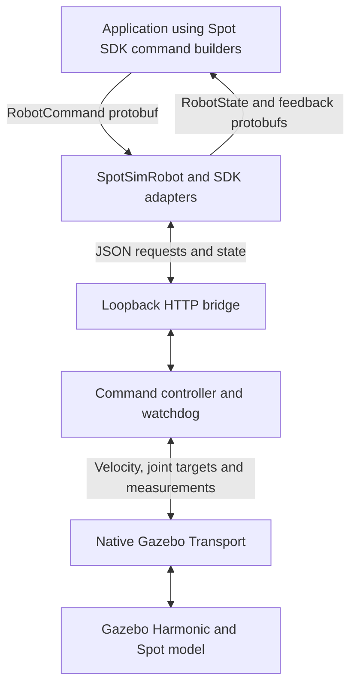

# Spot Gazebo SDK Bridge

A Gazebo Harmonic development environment that loads the upstream Spot URDF and
meshes and connects selected Boston Dynamics Python SDK commands to the simulator.

> **Current scope: kinematic mobility and SDK integration testing.** Body motion
> is applied directly through Gazebo's `VelocityControl` plugin. Leg joints follow
> a separate periodic animation. Gravity and leg contact response are disabled.
> This project does **not** implement physically realistic walking, balance, or
> Boston Dynamics' locomotion controller.

The SDK connection is an application-level Python adapter, **not a Spot gRPC
server**. Existing applications must use `SpotSimRobot` in place of their normal
robot connection and service setup.

## Features and limitations

| Component | Current implementation |
| --- | --- |
| Robot model | Standard upstream Spot URDF, visual/collision meshes, 12 leg joints |
| Geometry and limits | Imported joint origins, axes, limits, and inertial data |
| Mobility | Direct planar body velocity plus a separate leg animation |
| Stand / sit | Nominal joint targets and direct body-height control |
| SDK input | Actual `RobotCommandBuilder` protobuf messages |
| SDK output | Actual `RobotState` and command-feedback protobuf messages |
| Supported commands | Nominal stand, sit, stop, SE2 velocity |
| State | Measured Gazebo pose, velocity, and joint angles; software power flag |
| Dynamics | No gravity-driven balance or foot-ground propulsion |
| Spot services | No authentication, lease, E-stop, discovery, or time-sync services |
| Other features | No arm, cameras, perception, GraphNav, or obstacle avoidance |

This is useful for exercising the supported application command/state flow.
It cannot validate gait stability, traction, falls, rough-terrain locomotion,
actuator performance, or real-robot safety.

## Requirements

Tested environment:

- Ubuntu 24.04, Python 3.12.
- ROS 2 Jazzy and Gazebo Harmonic (`gz sim` 8).
- Xacro and `ament_index_python` for expanding the robot description.
- Gazebo Python bindings: `gz.transport13` and `gz.msgs10`.
- Boston Dynamics Python SDK 5.2.0 for the SDK example and adapter tests.
- Git and Python virtual-environment support.

ROS nodes and `ros_gz_bridge` are not used in the runtime command path. ROS 2
supplies environment setup and description tooling in the tested installation.

On a machine with the ROS 2 Jazzy and Gazebo Harmonic apt repositories already
configured, the relevant packages include:

```bash
sudo apt install ros-jazzy-ros-gz ros-jazzy-xacro \
  python3-gz-transport13 python3-gz-msgs10 python3-venv
```

Gazebo's Python bindings must be available to the system Python interpreter:

```bash
source /opt/ros/jazzy/setup.bash
python3 -c 'import xacro; import ament_index_python; import gz.transport13; import gz.msgs10'
gz sim --versions
```

## Quick start

Clone with submodules to obtain the pinned robot description and meshes:

```bash
git clone --recurse-submodules https://github.com/i-singhal/spot-gazebo.git
cd spot-gazebo
```

If you cloned without submodules:

```bash
git submodule update --init --recursive
```

Install the SDK into a local virtual environment:

```bash
./setup_sdk.sh
```

The environment uses `--system-site-packages` so it can reuse the system Gazebo
Python bindings. The bridge process itself does not depend on `bosdyn-client`.

Start Gazebo and the bridge:

```bash
./run.sh
# For a server-only simulation:
# ./run.sh --headless
```

Wait for:

```text
Ready: Spot in Gazebo; SDK bridge http://127.0.0.1:8080
```

In a second terminal, from the repository root:

```bash
PYTHONPATH=. .venv/bin/python examples/sdk_demo.py
```

The example stands, commands forward movement, lateral movement and turning,
prints measured poses, then sits and switches the software power flag off.
Press Ctrl-C in the launcher terminal to shut down the bridge and Gazebo.

`run.sh` sources `/opt/ros/jazzy/setup.bash` when available. To select a different
bridge port, pass `--port 8081` and provide `--url http://127.0.0.1:8081` to the
example or smoke test. The default Gazebo partition is `spot_gazebo`; override it
with `GZ_PARTITION` if needed. Run one Spot instance per partition.

## Using the SDK adapter

```python
import time

from bosdyn.client.frame_helpers import get_odom_tform_body
from bosdyn.client.robot_command import RobotCommandBuilder, blocking_stand
from spot_gazebo.sdk import SpotSimRobot

robot = SpotSimRobot("http://127.0.0.1:8080")
commands = robot.ensure_client("robot-command")
states = robot.ensure_client("robot-state")

robot.power_on()
try:
    blocking_stand(commands, timeout_sec=10)
    commands.robot_command(
        RobotCommandBuilder.synchro_velocity_command(0.3, 0.0, 0.0),
        end_time_secs=time.time() + 2.0,
    )
    time.sleep(2.3)
    state = states.get_robot_state()
    print(get_odom_tform_body(state.kinematic_state.transforms_snapshot))
finally:
    commands.robot_command(RobotCommandBuilder.stop_command())
    robot.power_off()
```

`ensure_client` returns custom synchronous adapters, not SDK gRPC client
instances. SDK helpers such as `blocking_stand`, `blocking_sit`, and frame helpers
can operate on the supported methods and returned messages. A normal
`create_standard_sdk().create_robot(...)` connection cannot use this HTTP server.

Non-default mobility parameters, trajectory commands, arm/gripper commands, and
unsupported services raise errors. Asynchronous calls and full SDK exception
semantics are not implemented. Some SDK-style timeout arguments are accepted but
do not configure the underlying HTTP timeout.

## Architecture



There are three processes: your application, the Python bridge server, and
Gazebo. The launcher starts and monitors the latter two.

### Model generation

`tools/generate_world.py` expands the standard upstream Xacro with
`arm:=false feet:=true add_ros2_control_tag:=false`. It provides a local ament
index instead of requiring installation of the description package.

The generator preserves the expanded source in `models/spot/spot.urdf`, resolves
mesh paths in a simulation copy, and moves the body inertia from a coincident
fixed child onto `body` for Gazebo's URDF importer. It converts the result to SDF
and adds controllers and world plugins. Upstream source files are not edited.

Generated simulation URDF/SDF files contain absolute local mesh paths and are
excluded from Git. The launcher regenerates them on startup. All robot assets
are supplied by the submodule; Gazebo does not need runtime Fuel downloads.

### Control and feedback

- The bridge loop runs approximately every 20 ms (50 Hz), using wall time.
- Gazebo is configured with a maximum physics step of 2 ms and target real-time
  factor of 1. These settings do not guarantee real-time execution.
- Body movement uses `/model/spot/cmd_vel`, a Gazebo `Twist` topic.
- Twelve joint position controllers receive targets on
  `/model/spot/joint/<upstream_joint_name>/cmd_pos`.
- Joint controllers use velocity-command mode rather than a calibrated motor
  torque model. A fixed 1.6 Hz diagonal leg animation runs during motion.
- Nominal body-frame heights are 0.55 m standing and 0.27 m sitting. A proportional
  vertical-velocity controller changes body height directly.
- Stand/sit completion requires fresh odometry, height error below 0.015 m, and
  all twelve joint angle errors below 0.08 rad.
- `/model/spot/odometry` and `/model/spot/joint_state` supply measured simulated
  state. Twist is rotated into the odometry frame for SDK state output.
- The controller is protected by a lock because HTTP handlers, transport
  callbacks, and the control loop share state. It retains 256 command records.

### Frames, limits, and timing

| Setting | Behavior |
| --- | --- |
| Axes | X forward, Y left, Z up; positive yaw turns left |
| Velocity frames | `body` / `flat_body`, `odom`, `vision` |
| Frame simplifications | `body` and `flat_body` treated equivalently; `vision` equals `odom` |
| Speed limits | 1 m/s per planar axis; 1.5 rad/s yaw |
| Velocity duration | Greater than zero, at most 10 seconds |
| Expiration | Adapter converts wall-clock end time to duration; server uses monotonic deadline |
| Stale state | Odometry older than 0.5 seconds stops the requested motion |
| Pause behavior | Commands can expire while Gazebo is paused |
| Preemption | A newly accepted command overrides the previous active command |

The watchdog operates in the bridge process. Graceful shutdown publishes zero
velocity; a forced bridge termination is not covered by an independent
Gazebo-side watchdog. The software power flag gates mobility but does not
simulate disconnecting motor power: posture targets continue to be published.

The SDK frame tree is `vision → odom → body`. Joint names such as
`front_left_hip_x` are mapped to `fl.hx`. State uses simulator measurements without
sensor noise or drift. Its timestamp is response construction time, not a
synchronized timestamp of all Gazebo samples. Joint velocity, torque, battery,
and foot-contact fields are not populated.

## Tests

Generate the local simulation artifacts before running tests:

```bash
source /opt/ros/jazzy/setup.bash
python3 tools/generate_world.py
.venv/bin/python -m unittest discover -s tests -v
gz sdf -k worlds/spot.sdf
```

The suite contains 25 tests covering controller deadlines and preemption,
coordinate conversion, nominal pose completion, imported joint properties and
mesh references, actual SDK protobuf translation, and Gazebo message callbacks.
SDK tests skip if `bosdyn-client` is absent.

For a live smoke test, start a fresh simulation:

```bash
./run.sh --headless
```

Then run in another terminal from the repository root:

```bash
PYTHONPATH=. .venv/bin/python tools/smoke_test.py --sdk
```

A dependency-free diagnostic version is also available:

```bash
PYTHONPATH=. python3 tools/smoke_test.py
```

The live test checks measured forward displacement, lateral displacement,
heading change, stopping after expiration, SDK state retrieval, and sitting.
Start from a fresh simulation because its assertions assume the initial pose.

**Recorded validation:** 25 automated tests passed; generated SDF passed Gazebo
validation; the SDK smoke test passed against headless Gazebo. GUI appearance has
not been visually inspected. Passing these checks validates the implemented
command/state path, not realistic locomotion or hardware equivalence.

## Diagnostics

The bridge listens on loopback only and has no authentication or TLS.

| HTTP endpoint | Purpose |
| --- | --- |
| `GET /state` | Latest pose, velocity, joints, power flag, and readiness |
| `GET /health` | Same state and readiness information |
| `POST /power` | Set software power flag with `{"on": true}` |
| `POST /command` | Submit a normalized command; returns `{"id": ...}` |
| `GET /feedback?id=1` | Read processing, overridden, or timed-out feedback |

```bash
curl http://127.0.0.1:8080/health
source /opt/ros/jazzy/setup.bash
GZ_PARTITION=spot_gazebo gz topic -l
```

If the launcher reports missing sockets or `PermissionError`, run it outside a
socket-restricted execution sandbox. If no odometry arrives, check that Gazebo
is running unpaused and the bridge and simulator use the same partition. Missing
`spot_description` files usually mean the Git submodule was not initialized.

## Repository layout

```text
spot_gazebo/            Controller, transport backend, HTTP server, SDK adapters
examples/sdk_demo.py    Supported SDK command/state example
tools/generate_world.py Xacro expansion and Gazebo world generation
tools/smoke_test.py     Live measured-motion verification
tests/                 Controller, model, SDK, and transport tests
models/spot/spot.urdf   Expanded upstream robot description
vendor/spot_description Pinned upstream source and meshes (Git submodule)
vendor/SOURCES.md      Source revision, licensing, and conversion notes
run.sh                 Gazebo + bridge launcher
setup_sdk.sh           Local SDK virtual-environment setup
```

## Future work toward physical locomotion

- Enable gravity and foot-ground contacts; validate physical parameters.
- Replace direct base velocity with joint actuation under force/effort limits.
- Integrate a controller for standing, contact scheduling, foot trajectories,
  body stabilization, and controlled stand/sit transitions.
- Validate slipping, falls, disturbances, terrain interaction, and actuator limits.
- Add sensors, synchronized measurements, and simulator-side timeout handling.
- Expand SDK service compatibility separately from locomotion.

## Sources and attribution

The robot description and assets are from
[RAI Institute's spot_description](https://github.com/rai-opensource/spot_description),
pinned to `156d1802bfb117f219dbfce7597d283d5fabc968`. Their upstream MIT and BSD
notices are retained in the submodule. See [vendor/SOURCES.md](vendor/SOURCES.md).
This project is not an official Boston Dynamics simulator.

References: [Spot SDK](https://github.com/boston-dynamics/spot-sdk),
[Gazebo Transport Python API](https://gazebosim.org/api/transport/13/python.html),
and [Gazebo joint controllers](https://gazebosim.org/api/sim/8/jointcontrollers.html).
